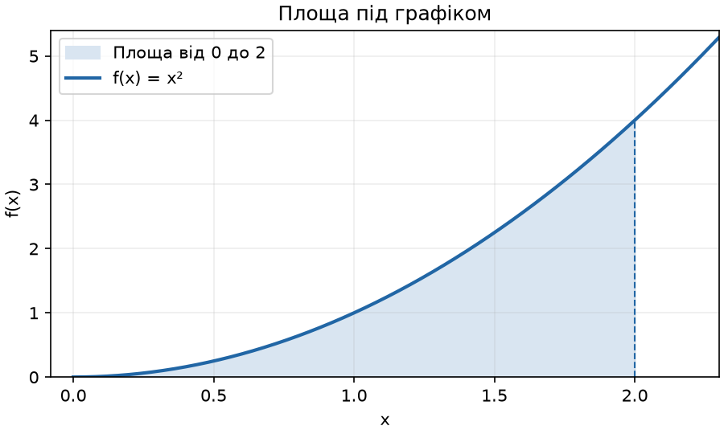

# Домашнє завдання 10. Монети та метод Монте-Карло

## Як запустити

Відкрийте папку у VS Code і виконайте в терміналі:

```powershell
py task_1.py
py task_2.py
```

Якщо ваша команда запуску Python називається `python`, використайте її замість `py`.
Додаткові бібліотеки не потрібні.

## Завдання 1. Видача решти

- `find_coins_greedy` бере якомога більше монет найбільшого номіналу, а потім переходить до меншого.
- `find_min_coins` рахує, скільки монет потрібно для кожної суми від 0 до заданої. Функція запам’ятовує останню монету для кожної суми й за цими записами складає відповідь.

Для суми `113` обидві функції повертають `{50: 2, 10: 1, 2: 1, 1: 1}`. Це п’ять монет.

Жадібний алгоритм проходить через кожен номінал один раз. Для шести номіналів це шість кроків незалежно від суми. Його час роботи — `O(k)`, де `k` — кількість номіналів.

Динамічне програмування для кожної суми до `A` перевіряє всі номінали. Час роботи — `O(A × k)`. Для суми `100 000` це `100 000 × 6` перевірок і два списки на `100 001` елемент, тому на великих сумах жадібний алгоритм швидший і потребує менше пам’яті.

Перевага динамічного програмування в тому, що воно знаходить мінімальну кількість монет і з іншими номіналами. Наприклад, для монет `4, 3, 1` та суми `6` жадібний алгоритм бере `4 + 1 + 1`, хоча `3 + 3` потребує лише двох монет.

## Завдання 2. Інтеграл методом Монте-Карло

Знаходжу площу під графіком `f(x) = x²` від `0` до `2`.



Генерую `100 000` випадкових точок у прямокутнику шириною `2` і висотою `4`. Підраховую частку точок під кривою та множу її на площу прямокутника `8`.

| Розрахунок | Значення |
| --- | ---: |
| Монте-Карло | 2,659680 |
| Точне значення | 2,666667 |
| Абсолютна похибка | 0,006987 |

Точний результат можна знайти вручну. Первісна для `x²` — `x³ / 3`. Підставляю межі й отримую `(2³ − 0³) / 3 = 8/3`.

Результат Монте-Карло близький до точного. Похибка в цьому запуску становить близько `0,26%`. Якщо змінити набір випадкових точок, результат трохи зміниться. З більшою кількістю точок оцінка зазвичай точніша.
